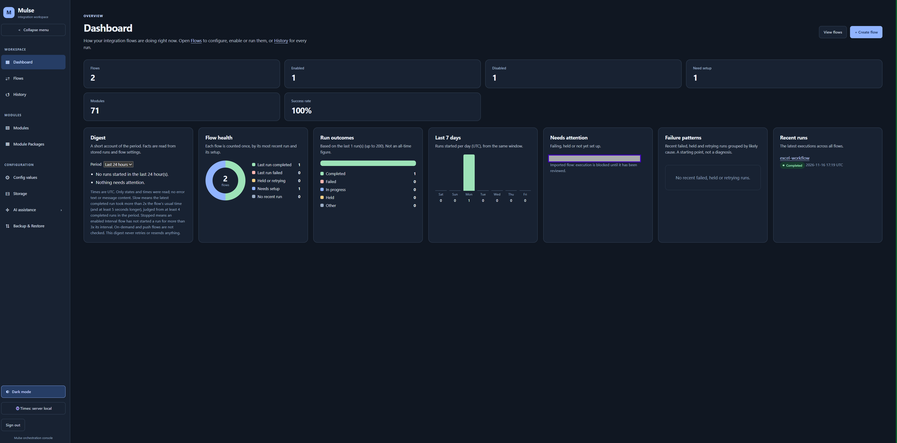

# Mulse

Mulse is an in-development .NET integration platform. Build flows in a browser-based designer or through an API to fetch, parse, transform, render, and deliver data. Use built-in modules or add plugins for Excel, HL7, SQL Server, or your own integrations.

The BizTalk importer creates disabled draft flows for review. It does not guarantee a complete migration or equivalent behavior.

**Status:** Not production-ready. Test flows with sample data before connecting real systems. The inbound HTTP endpoint is anonymous; do not expose it to untrusted networks.

## Screenshots



See the [screenshot gallery](docs/screenshots.md) for the flow designer, BizTalk import review, native orchestration, execution history, modules, configuration, and storage views.

## Run locally

Install the **.NET 11 SDK** and start Docker in **Linux container mode**. Follow the [one-time Aspire setup](docs/feature-reference.md#run-with-aspire), including the instructions to [reuse an existing Keycloak database](docs/feature-reference.md#reuse-the-compose-keycloak-database) if you already use `compose.auth.yml`.

Select **Mulse (Aspire)** in Visual Studio's startup dropdown and press **F5**, or run this from the repository root:

```powershell
dotnet run --project .\Mulse.AppHost\Mulse.AppHost.csproj
```

Aspire starts Service, UI, Keycloak, and Keycloak's PostgreSQL database. Open [Mulse](https://localhost:7021) or the [Keycloak admin console](http://localhost:8081). On a fresh database, [configure the Mulse realm and OIDC clients](docs/feature-reference.md#mulse-oidc-authentication) before signing into Mulse. Mulse itself still uses SQLite by default.

For faster restarts, [keep Keycloak running in Docker](docs/feature-reference.md#run-with-an-existing-keycloak) and use **Mulse (Aspire, existing Keycloak)**. This profile starts only Service and UI.

## Run with Docker Compose

[Run Service and UI as separate containers](docs/docker-compose.md) without Visual Studio or Aspire. Use bundled Keycloak or connect to an existing HTTPS OIDC provider.

## Documentation

- [Screenshot gallery](docs/screenshots.md) - dashboard, designer, and administration views
- [Feature reference](docs/feature-reference.md) - flow design, execution, storage, and API behavior
- [Module developer guide](Module-Developer-Guide.md) - build and load custom modules
- [BizTalk import compatibility plan](BizTalk-Import-Compatibility-Plan.md) - supported behavior and known gaps
- [Service container publishing](Service/README.md)
