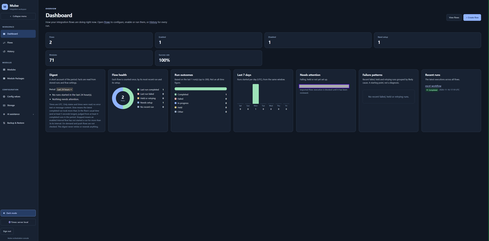
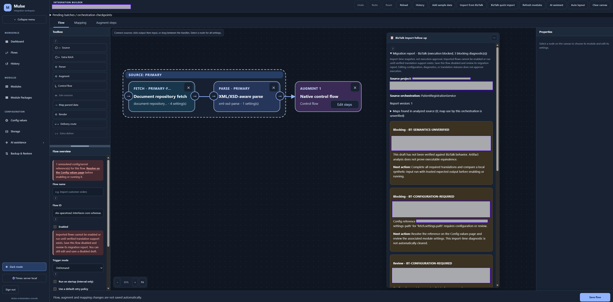
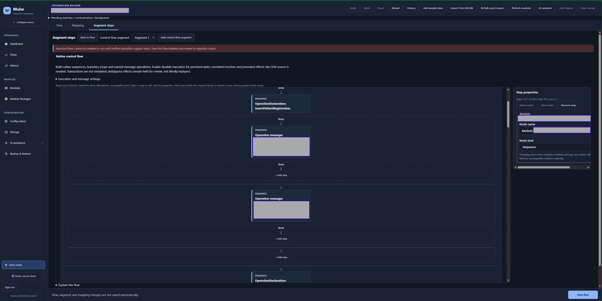
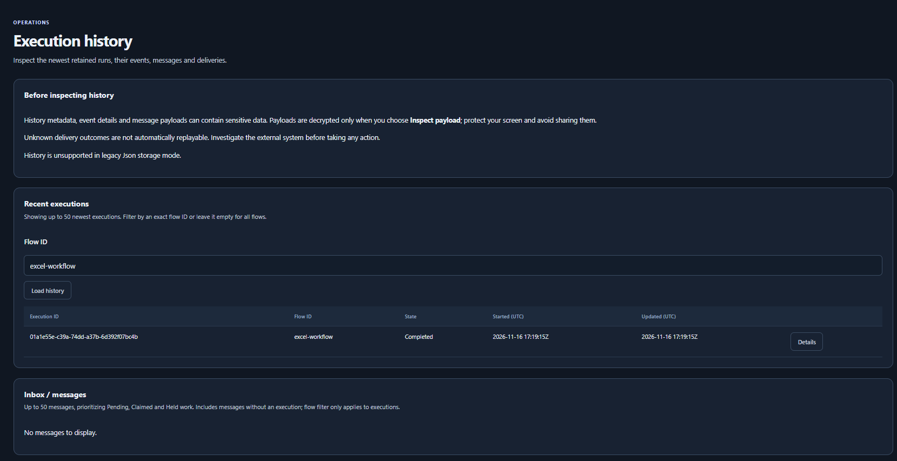
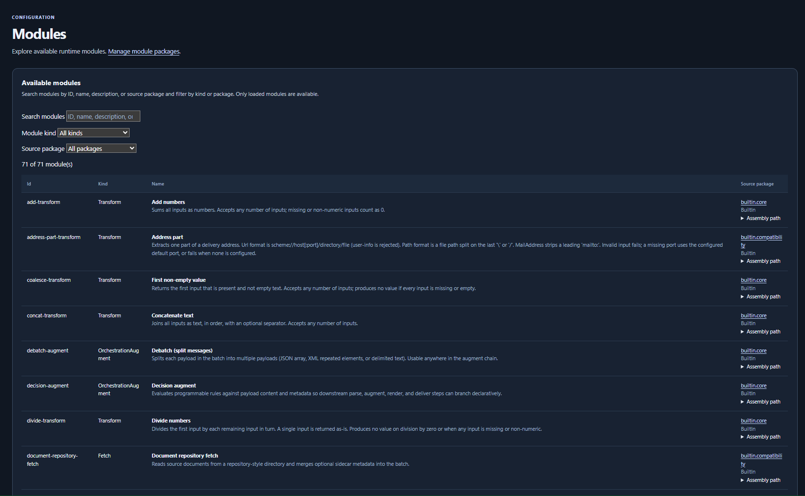
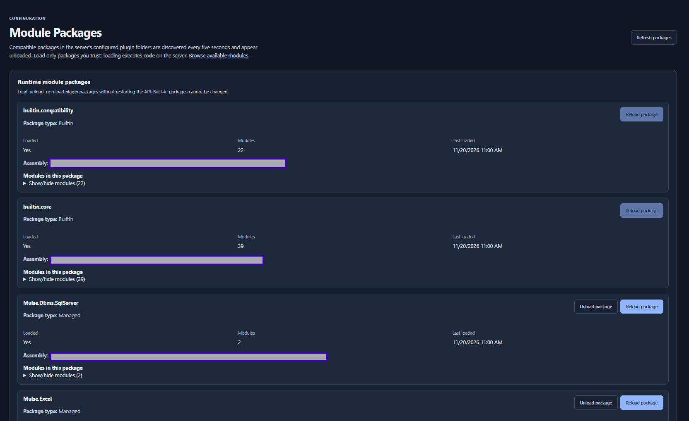
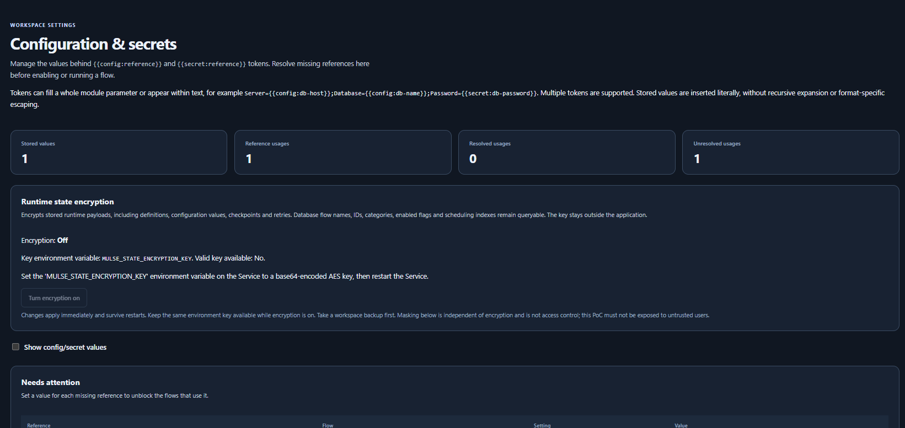
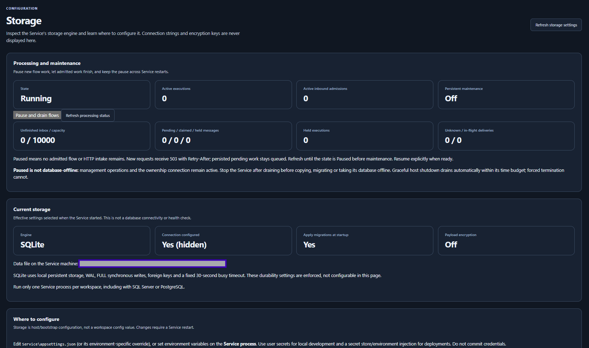

# Mulse screenshots

The screenshots below show the dashboard, flow authoring, BizTalk import review, and administration views.

## Dashboard

The dashboard summarizes flow health, recent runs, module count, and flows that need attention.

## Flow designer

Connect fetch, parse, and augment steps in the visual flow designer. The example also shows the review panel for an imported BizTalk flow; imports remain drafts until reviewed and verified.

## Native control flow

Build native orchestration sequences and configure their nested steps in the designer.

## Execution history

Inspect recent executions, events, messages, and delivery outcomes from History.

## Modules

Browse the runtime's available modules and filter the catalog.

Manage trusted plugin packages separately from the built-in modules.

## Configuration and storage

Manage configuration values and resolve missing references before enabling flows.

Inspect the active storage provider and maintenance status.

